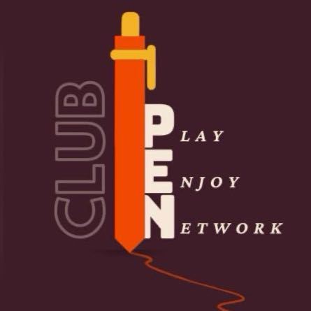

# PEN Club Website



## About PEN Club

**PEN Club** stands for **Play, Enjoy, Network** - a vibrant community for Azerbaijani youth in Poland. Our club brings together young people for sports, games, networking events, and social activities.

## 🚀 Features

- **Modern React Application**: Built with React 18 and Vite for optimal performance
- **Responsive Design**: Fully responsive layout that works on all devices
- **Tailwind CSS**: Utility-first CSS framework for rapid UI development
- **React Router**: Seamless navigation between pages
- **Interactive Components**: Engaging UI with smooth animations and transitions

## 📋 Pages

See the [route reference](ROUTES.md) for all public and admin URLs, parameters, and access requirements.

- **Home**: Welcome page with hero section, features, and call-to-action
- **About**: Information about PEN Club's mission and activities
- **Events**: Upcoming and past events showcase
- **Gallery**: Photo gallery (coming soon)
- **Contact**: Contact form and information

## 🛠️ Tech Stack

- **React 18.2.0**: JavaScript library for building user interfaces
- **React Router DOM 6.20.0**: Declarative routing for React
- **Vite 5.0.8**: Next-generation frontend tooling
- **Tailwind CSS 3.4.0**: Utility-first CSS framework
- **PostCSS & Autoprefixer**: CSS processing tools

## 📦 Installation

1. **Clone the repository**
   ```bash
   git clone <repository-url>
   cd PEN-Club
   ```

2. **Install dependencies**
   ```bash
   npm install
   ```

3. **Add your logo**
   - Place your logo image in the `public` folder as `logo.jpeg`

## 🚀 Running the Application

### Development Mode
```bash
npm run dev
```
The application will start on `http://localhost:3000` (or the next available port)

Local API calls use `http://localhost:8080/api/v1`, configured in `.env.development`. Run the backend on port `8080` and allow requests from `http://localhost:3000` in its CORS configuration. Restart Vite after changing environment files.

This development setting overrides the API URL in `.env` and `.env.local` when running `npm run dev`. Production builds continue to use the existing production environment configuration. For a personal development override, set `VITE_API_BASE_URL` in `.env.development.local`.

### Build for Production
```bash
npm run build
```
This creates an optimized production build in the `dist` folder

### Preview Production Build
```bash
npm run preview
```

## 📁 Project Structure

```
PEN-Club/
├── public/
│   └── logo.jpeg             # Club logo
├── src/
│   ├── components/           # Reusable components
│   │   ├── Navbar.jsx       # Navigation bar
│   │   ├── Footer.jsx       # Footer component
│   │   └── Hero.jsx         # Hero section
│   ├── pages/               # Page components
│   │   ├── Home.jsx         # Home page
│   │   ├── About.jsx        # About page
│   │   ├── Events.jsx       # Events page
│   │   ├── EventDetail.jsx  # Event detail page
│   │   ├── Gallery.jsx      # Gallery page
│   │   └── Contact.jsx      # Contact page
│   ├── styles/              # Global styles
│   │   └── global.css       # Global CSS with Tailwind
│   ├── App.jsx              # Main app component
│   ├── App.css              # App-specific styles
│   └── index.jsx            # Entry point
├── index.html               # HTML template
├── tailwind.config.js       # Tailwind configuration
├── postcss.config.js        # PostCSS configuration
├── vite.config.js           # Vite configuration
└── package.json             # Project dependencies

```

## 🎨 Customization

### Colors
The color scheme is defined in `tailwind.config.js`:
- **Primary**: `#3d2b2e` (Dark purple/brown)
- **Secondary**: `#ff6b35` (Orange)
- **Accent**: `#f7931e` (Light orange)

### Fonts
Default font family: Segoe UI, Tahoma, Geneva, Verdana, sans-serif

### Modifying Content
- Update page content in `src/pages/`
- Modify components in `src/components/`
- Adjust global styles in `src/styles/global.css`

## 🔧 Configuration Files

### Tailwind Config (`tailwind.config.js`)
- Custom colors and theme extensions
- Custom animations (float, fade-in)
- Responsive breakpoints

### Vite Config (`vite.config.js`)
- React plugin configuration
- Development server settings
- Build optimization

## 📱 Responsive Design

The website is fully responsive with breakpoints:
- **Mobile**: < 768px
- **Tablet**: 768px - 1024px
- **Desktop**: > 1024px

## 🌐 Browser Support

- Chrome (latest)
- Firefox (latest)
- Safari (latest)
- Edge (latest)

## 📝 Future Enhancements

- [ ] Add real event data and management system
- [ ] Implement photo gallery with image uploads
- [ ] Add user authentication and member profiles
- [ ] Integrate with backend API
- [ ] Add multilingual support (English/Azerbaijani)
- [ ] Implement event registration system
- [ ] Add social media integration
- [ ] Create admin dashboard

## 🤝 Contributing

Contributions are welcome! Please feel free to submit a Pull Request.

## 📄 License

This project is licensed under the MIT License.

## 📞 Contact

For questions or suggestions, please contact us through the website's contact form or reach out via social media.

---

**Made with ❤️ by PEN Club Team**

*Play • Enjoy • Network*
